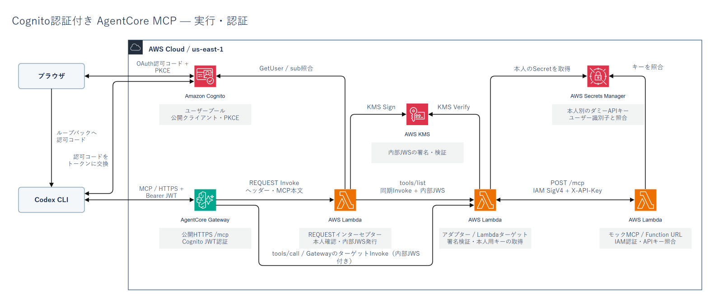
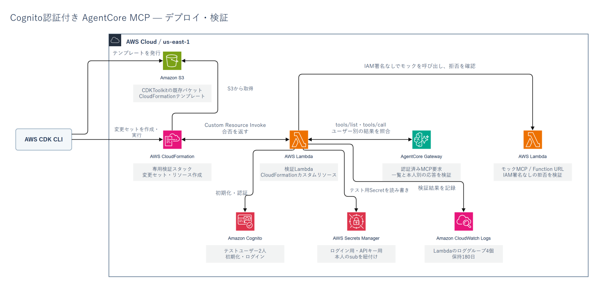

# Cognito認証付き AgentCore MCP 検証サンプル

Codex CLIからCognitoでログインし、Amazon Bedrock AgentCore Gateway経由でモックのMCPサーバーを呼び出すサンプルです。ログインしたユーザーごとに、AWS側で別のAPIキーを選びます。MCPサーバーはLambda上で動作し、検証用ツールを1つ提供します。

```text
Codex CLI ── Cognito発行のアクセストークン ──▶ AgentCore Gateway
                                                │
                                  インターセプターが本人情報にKMS署名
                                                │
                                  Lambdaアダプターが署名を検証
                                  Secrets Managerから本人用キーを取得
                                                │
                                       IAM署名とAPIキー
                                                ▼
                                          モックMCP Lambda
```

Gatewayは公開HTTPSエンドポイントです。専用Cognitoクライアントのアクセストークンを要求し、自己登録を無効にしています。モックのFunction URLにはIAM認証を設定しています。インターセプターは `tools/list` でモックの一覧を中継し、`tools/call` でクライアントから渡された予約引数を署名付きの本人情報で置き換えます。

## 構成図

### 実行・認証



### デプロイ・検証



## デプロイ

Node.js、npm、Python 3（`python` コマンド）、AWS認証プロファイルが必要です。このサンプルのデプロイ先は `us-east-1` です。対象アカウントとリージョンでCDKのブートストラップを済ませてください。下の `deployment-profile` は使用するAWSプロファイル名に置き換えます。

```sh
npm ci
npm run cdk -- synth --profile deployment-profile
npm run cdk -- diff --profile deployment-profile
npm run cdk -- deploy --profile deployment-profile
```

CloudFormationが `owner` と `codex` のテストユーザーを作り、Secrets ManagerがパスワードとダミーAPIキーを生成します。デプロイ時の検証Lambdaは、匿名・無効トークンの拒否、モックURLのIAM認証、モック由来のツール一覧、ユーザー別の呼び出し結果を確認します。結果はスタック出力 `Verification` に表示されます。

## Codex CLIから接続する

1. リポジトリルートに `.codex/` を作り、`config.toml.example` を `.codex/config.toml` としてコピーします。スタック出力の `GatewayUrl` と `ClientId` を設定に入れます。Cognitoクライアントは公開クライアントで、PKCEを使います。
2. リポジトリルートで `codex mcp login pleasanter_probe --no-browser` を実行します。表示された認可URLの `redirect_uri` をURLデコードし、コールバックURLを確認します。Gatewayごとに変わる末尾も含めて控え、Ctrl+Cでこの試行を終了します。
3. 確認したURLを `.codex/config.toml` のOAuthセクションに `callback_url` として追加し、同じ値を環境変数 `PROBE_CALLBACK_URL` に設定して、もう一度CDKでデプロイします。PowerShellなら `$env:PROBE_CALLBACK_URL = '<確認したコールバックURL>'` です。以後、このスタックを更新するときも同じ値を指定します。
4. `codex mcp login pleasanter_probe` を実行し、ブラウザで `owner` として認証します。パスワードは、スタック出力 `OwnerLoginSecret` が指すSecrets Managerの `password` の値です。
5. Windowsでは `python verify_codex.py --account owner` を実行します。Codex CLI実行ファイルが既定名と違う場合は `--codex-bin` で指定します。macOS・Linuxでは `python verify_codex.py --codex-bin codex --account owner` を使います。

実環境では、Codexがブラウザ認証後にモック固有のツール説明を取得し、`mock___whoami` の結果として `mock-account:owner` を受け取りました。AWS内の検証では、同じツールが `codex` ユーザーに `mock-account:codex` を返すことも確認しています。

## 後片付け

`npm run cdk -- destroy --profile deployment-profile` で検証スタックを削除します。テストユーザー、シークレット、Lambda、ロググループなどが削除対象です。KMS鍵は7日間の削除待ちに入ります。CDKの共有ブートストラップリソースと、そこに発行したテンプレート資産は検証スタックとは別管理です。
